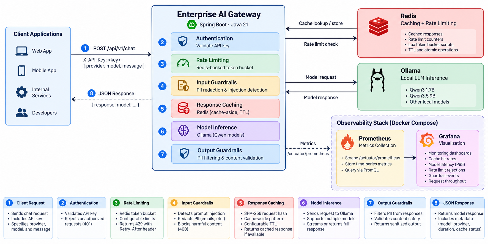

# Enterprise AI Gateway

**A Spring Boot gateway for local LLM inference with Redis caching, distributed rate limiting, configurable guardrails, and Prometheus/Grafana monitoring.**

Built as a hands-on AI infrastructure portfolio project using Java 21, Spring Boot, Gradle, Ollama, Redis, Docker Compose, Micrometer, Prometheus, and Grafana.

> **Project status:** Local development prototype. The features below reflect the implementation described in this project; automated security validation, hardened identity management, and cloud deployment are future work. This is not yet a production-ready, multi-tenant service.

## Features

| Capability | Implementation |
| --- | --- |
| LLM integration | Provider interface (`LlmProvider`) and Ollama adapter; model allowlist |
| Response caching | Redis cache-aside pattern, hashed request keys, configurable TTL |
| Distributed rate limiting | Redis Lua token bucket; HTTP `429 Too Many Requests` and `Retry-After` |
| Input guardrails | Email/SSN redaction and basic prompt-injection pattern checks |
| Output guardrails | Output PII redaction, including on cached responses |
| Metrics | Micrometer/Actuator metrics exported to Prometheus |
| Dashboards | Grafana visualizations for latency, cache usage, and rejected requests |
| Architecture | Modular Spring services separating routing, caching, limits, and guardrails |

## Architecture



**Request flow:** Authenticate → enforce quota → apply input guardrails → look up tenant-scoped cache entry → invoke Ollama if needed → validate the output → cache eligible responses → return the result. Rate limiting runs before cache lookup, so cached requests also count toward the quota.

## Tech stack

- **Backend:** Java 21, Spring Boot 3.x, Gradle
- **LLMs:** Ollama (for example `qwen3:1.7b` or your installed `qwen3.5:9b`)
- **Caching and coordination:** Redis
- **Monitoring:** Spring Boot Actuator, Micrometer, Prometheus, Grafana
- **Infrastructure:** Docker Compose
- **Testing:** JUnit 5 / Spring Boot Test (expand test coverage as the project evolves)

## Prerequisites

- JDK 21
- Docker Desktop with Docker Compose
- Ollama installed and running on your computer
- A locally available Ollama model

Pull a model if needed:

```bash
ollama pull qwen3:1.7b
ollama list
```

> Use the **exact** model name printed by `ollama list`, including its tag. Larger models may take noticeably longer to respond; the gateway does not guarantee inference speed.

## Getting started

### 1. Clone the repository

```bash
git clone https://github.com/YOUR_USERNAME/enterprise-ai-gateway.git
cd enterprise-ai-gateway
```

Replace `YOUR_USERNAME` with your GitHub username after publishing.

### 2. Configure local environment

```bash
export GATEWAY_API_KEY="$(openssl rand -hex 32)"
export GRAFANA_ADMIN_PASSWORD="$(openssl rand -hex 24)"
```

Keep these values private. Start Spring Boot from the same environment, or add them to your IDE run configuration. If you use a local `.env` file, **never commit it**.

Review `src/main/resources/application.yml` and make sure the Ollama model allowlist includes the model you're going to request:

```yaml
spring:
  data:
    redis:
      host: localhost
      port: 6379

gateway:
  api-key: ${GATEWAY_API_KEY}
  cache:
    enabled: true
    ttl: 10m
  rate-limit:
    capacity: 10
    refill-tokens: 10
    refill-period: 60s

ai:
  ollama:
    base-url: http://localhost:11434
    allowed-models: qwen3:1.7b,qwen3.5:9b

management:
  endpoints:
    web:
      exposure:
        include: health,info,prometheus,metrics
```

This is an **illustrative configuration**: merge it into your existing YAML rather than overwriting other application settings. The configuration assumes Spring Boot runs on your Mac/host and Redis runs in Docker.

### 3. Start supporting services

```bash
docker compose up -d

docker compose ps
```

Your `compose.yaml` should define `redis`, `prometheus`, and `grafana`. Confirm `monitoring/prometheus.yml` is a regular file (not a directory). On Docker Desktop for Mac, Prometheus can scrape Spring Boot running on the host using `host.docker.internal:8080`.

### 4. Start Ollama and Spring Boot

Make sure the Ollama service is running, then:

```bash
./gradlew bootRun
```

Or run `AiGatewayApplication` from IntelliJ with `GATEWAY_API_KEY` configured in its environment.

### 5. Send a chat request

```bash
curl -i -X POST http://localhost:8080/api/v1/chat \
  -H 'Content-Type: application/json' \
  -H "X-API-Key: $GATEWAY_API_KEY" \
  -d '{
    "provider": "ollama",
    "model": "qwen3:1.7b",
    "message": "Explain Redis caching in two sentences."
  }'
```

Sample response **shape** (text and timing vary by model and hardware):

```json
{
  "provider": "ollama",
  "model": "qwen3:1.7b",
  "response": "Redis caches frequently reused results...",
  "latencyMs": 1250,
  "cached": false
}
```

Send the **same request again** within the configured TTL. If Redis is connected and caching is enabled, the second response should have `"cached": true`.

## Rate limiting

The gateway uses a Redis-backed token bucket, updated atomically through a Lua script. With the example configuration, a client can make a short burst of 10 requests, with tokens replenished at approximately 10 per minute. Because refill is continuous, outcomes depend on request timing.

If the bucket has insufficient tokens, the gateway returns **HTTP 429** with a `Retry-After` header:

```http
HTTP/1.1 429 Too Many Requests
Retry-After: 6
```

Inspect Redis keys in local development:

```bash
docker compose exec redis redis-cli --scan --pattern 'ai:ratelimit:v1:*'
docker compose exec redis redis-cli --scan --pattern 'ai:chat:v1:*'
```

Do not treat API-key hashing and the current shared development credential as full tenant authentication. Production-grade identity, credential rotation, tenant-specific permissions, and quota administration remain to be implemented.

## Guardrails

The project currently demonstrates an extensible guardrail pipeline:

- **Input:** basic prompt-injection pattern checks plus email/SSN redaction before model invocation.
- **Output:** email/SSN redaction after inference and again on cache hits.
- **Caching:** cache only outputs that pass the current output policy.

These are **demonstration controls, not comprehensive protection**. Simple regexes cannot reliably detect all PII or prompt-injection attacks and can reject benign text. Do not submit real customer secrets or regulated personal data to this prototype. Future improvements include policy versioning in cache keys, structured-output validation, layered prompt-injection defenses, audit events, and systematic adversarial evaluation.

## Observability

| Service | Local address | Purpose |
| --- | --- | --- |
| Spring Boot metrics | http://localhost:8080/actuator/prometheus | Metrics exposition |
| Prometheus | http://localhost:9090/targets | Scrape status and queries |
| Grafana | http://localhost:3000 | Metrics dashboards |

When configuring the **Grafana Prometheus data source**, use **`http://prometheus:9090`**, not `http://localhost:9090` (the latter points at the Grafana container itself).

Recommended dashboard panels:

**Redis cache hit percentage**

```promql
100 * sum(rate(ai_gateway_cache_requests_total{result="hit"}[5m]))
/ clamp_min(sum(rate(ai_gateway_cache_requests_total[5m])), 0.000001)
```

**P95 LLM inference latency**

```promql
histogram_quantile(0.95,
  sum by (le, model) (rate(ai_gateway_model_duration_seconds_bucket[5m]))
)
```

**Rate-limit rejections per second**

```promql
sum(rate(ai_gateway_rate_limit_rejections_total[5m]))
```

These queries require the corresponding custom meters to be **registered and invoked** by application code; panels may show no data until the gateway processes traffic and Prometheus has scraped multiple samples. Avoid prompt text and raw API keys in metric labels.

### Screenshots

Add genuine screenshots from your running local environment to `docs/screenshots/` and then uncomment these lines:

```markdown
<!--  -->
<!--  -->
```

For a portable demonstration, export Grafana's dashboard JSON under `monitoring/grafana/dashboards/` and provision it through Compose. See Grafana's [provisioning documentation](https://grafana.com/docs/grafana/latest/administration/provisioning/).

## Build and test

```bash
./gradlew clean build
./gradlew test
```

Recommended test coverage:

- Cache hit avoids a second provider invocation; expired entries are regenerated.
- Different client keys and model names do not share cached responses.
- Redis cache outage falls back to inference (where configured).
- Concurrent requests cannot bypass the Redis token bucket.
- Throttled requests return HTTP 429 and `Retry-After`.
- Input PII redaction happens before the provider is called.
- Cached and uncached outputs both pass output guardrails.
- Unsupported providers or disallowed models fail safely.

**CI:** Add a GitHub Actions workflow running `./gradlew clean test` on pushes and pull requests. Keep tests hermetic or run Redis via Testcontainers; don't assume GitHub runners have Ollama models installed.

## Repository layout

```text
enterprise-ai-gateway/
├── src/main/java/com/example/aigateway/
│   ├── controller/
│   ├── dto/
│   ├── provider/
│   ├── guardrail/
│   ├── exception/
│   └── service/
├── src/main/resources/
│   ├── application.yml
│   └── scripts/token-bucket.lua
├── src/test/
├── monitoring/
│   └── prometheus.yml
├── compose.yaml
├── build.gradle
├── settings.gradle
└── README.md
```

Adjust package names and the tree to match the actual repository before publishing.

## Performance benchmarking

Avoid claiming specific latency or throughput improvements without measurement. For portfolio evidence, compare cold versus warm cache requests, model inference duration, cache hit percentage, and rate-limit rejection behavior. Record:

- Machine and RAM (for example Apple M1 Pro, 16 GB)
- Ollama model name and quantization
- Prompt, generation settings, and context size
- Request count, concurrency, warm-up method, and test duration
- Median/P95 latency, hit rate, and observed failures

Put reproducible commands and results in `docs/benchmarks.md`.

## Roadmap

- [x] Ollama provider integration
- [x] Redis response caching
- [x] Redis-backed rate limiting
- [x] Initial input/output guardrails
- [x] Basic Prometheus/Grafana integration
- [ ] Automated integration and concurrency tests
- [ ] Versioned prompt policies and structured-output contracts
- [ ] Model quality, safety, and latency evaluation suite
- [ ] Model routing and provider failover
- [ ] Stronger authentication and tenant administration
- [ ] React administration dashboard
- [ ] Public deployment and reproducible demo

## Security and limitations

- This is a local-development/portfolio implementation; **do not expose it to the public internet unchanged**.
- Keep secrets out of source control and screenshots; use environment variables or secret management.
- Restrict Redis, Ollama, Actuator, Prometheus, and Grafana to trusted networks.
- Rate-limit dependencies must fail safely; caching outages and throttling outages have different security implications.
- The current cache may store generated text: use retention and privacy policies before handling sensitive content.
- Review provider error handling, timeouts, request-size limits, and concurrency limits before deployment.

## License
Copyright (c) <year> <copyright holders>

Permission is hereby granted, free of charge, to any person obtaining a copy of this software and associated documentation files (the "Software"), to deal in the Software without restriction, including without limitation the rights to use, copy, modify, merge, publish, distribute, sublicense, and/or sell copies of the Software, and to permit persons to whom the Software is furnished to do so, subject to the following conditions:

The above copyright notice and this permission notice shall be included in all copies or substantial portions of the Software.

THE SOFTWARE IS PROVIDED "AS IS", WITHOUT WARRANTY OF ANY KIND, EXPRESS OR IMPLIED, INCLUDING BUT NOT LIMITED TO THE WARRANTIES OF MERCHANTABILITY, FITNESS FOR A PARTICULAR PURPOSE AND NONINFRINGEMENT. IN NO EVENT SHALL THE AUTHORS OR COPYRIGHT HOLDERS BE LIABLE FOR ANY CLAIM, DAMAGES OR OTHER LIABILITY, WHETHER IN AN ACTION OF CONTRACT, TORT OR OTHERWISE, ARISING FROM, OUT OF OR IN CONNECTION WITH THE SOFTWARE OR THE USE OR OTHER DEALINGS IN THE SOFTWARE.
